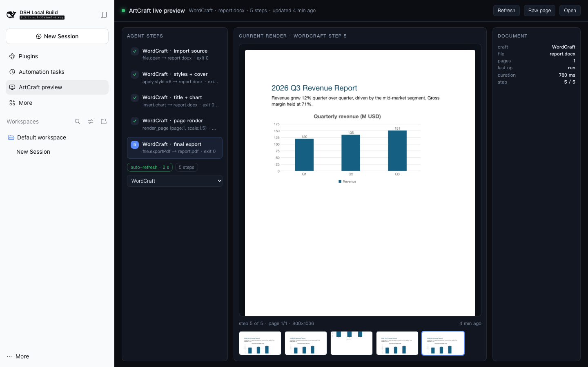

# ArtCraft live preview — DSH client panel (layer C)

A DSH Web GUI client plugin that puts the ArtCraft live preview inside the GUI:
a first-class **main panel** (full centre column) with a launcher row in the left
sidebar. It is the browser half of the three-layer preview contract in
[`../../docs/PREVIEW.md`](../../docs/PREVIEW.md):

| Layer | Owns |
|---|---|
| A | the render returned with each craft tool result |
| B | the local state directory + HTTP server on `127.0.0.1:4177` |
| **C** | **this package — the in-GUI panel that consumes layer B** |

The package ships both halves of layer C:

- **browser half** (`src/client.tsx` → `lib/client.js`) — the panel;
- **host half** (`src/index.ts` → `src/index.js`) — an ordinary Loader row that
  starts the packaged layer-B preview server when nothing is answering on
  `127.0.0.1:4177`. A profile install has no ArtCraft checkout to run layer B
  from, so the server and its page travel inside the package (`server/`, copied
  from `scripts/preview/` at build time). An already-running instance wins.



## What it shows

- **Header** — connection dot, `product · file · N steps · updated x s ago`,
  `Refresh`, `Raw page` (iframe), and `Open` (layer B in its own tab).
- **Agent steps** — every step in the current craft's `state.json`, with a check
  for completed steps, a highlighted current step, the operation summary, and a
  craft selector when more than one craft has been touched.
- **Current render** — the current step's `image` from `/img/<craft>/<file>`,
  with page/size caption and the clickable filmstrip of `thumb` images.
- **Document** — craft, file, pages, last op, duration, step position, plus the
  proportional **timeline** when the craft writes one (FilmCraft/EffectCraft).
- SoundCraft-style steps without an image render as text with a “no rendered
  image” stage instead of a broken image.

The data path is the documented one only:

- poll `GET http://127.0.0.1:4177/state` every 2 s (no SSE dependency), and
- load `GET http://127.0.0.1:4177/img/<craft>/<file>` as a plain ``.

`Raw page` embeds layer B's own page at `http://127.0.0.1:4177/` in an iframe for
a one-click full-fidelity fallback; `Open` always works, because it is a normal
link.

When `/state` cannot be read, the panel says why: the server may be down, or a
cross-origin read may have been refused for lack of `Access-Control-Allow-Origin`.
It keeps the last good snapshot through a transient failure and marks it `stale`.

### Preview server and origin policy

- The packaged server is the current layer-B implementation: loopback only,
  read-only, CORS granted to loopback origins, and the panel page frameable by
  loopback origins.
- Open the GUI on a loopback hostname (`127.0.0.1`/`localhost`). A GUI served
  through a LAN hostname is refused by layer B's CORS/framing policy; `Open`
  still shows the preview in its own tab.
- The server writes nothing; the craft plugins own the state directory
  (`$DSH_ARTCRAFT_PREVIEW_DIR`, or `$DSH_HOME/artcraft/preview`).

## Install

The panel needs no npm runtime dependencies: at runtime the browser side uses
only `react` and `react/jsx-runtime` (provided by the Web shell), and the host
side uses Node built-ins plus the packaged server.

### As a profile bundle (recommended)

This is the same shape as the craft plugins: a package whose `package.json`
declares `dsh.bundle.patch`, installed as a dependency of a DSH profile and
listed in the profile's `dsh.profile.bundles`. DSH applies the bundle's
`cordis.patch.yml` as one patch layer.

```sh
# from the ArtCraft workspace root
cd "$DSH_HOME/profiles/web"          # e.g. ~/.dsh/profiles/web
pnpm add file:/absolute/path/to/dsh-artcraft/dsh-plugins/preview-panel
```

Then add `"dsh-artcraft-preview-panel"` to `dsh.profile.bundles` in
`$DSH_HOME/profiles/web/package.json` (install the package first if the profile
has no `node_modules` yet), and restart the profile:

```sh
dsh --profile web
```

The left sidebar then shows an **ArtCraft preview** row; clicking it opens the
panel. (The GUI's own Plugins page can also install a packed tarball through
`plugin_manager`; either route ends with the package in `node_modules` and in
`dsh.profile.bundles`.)

### Manual patch row

If you would rather not make it a bundle, add this row to the profile's own
`cordis.patch.yml` (with the package installed in the profile's `node_modules`):

```yaml
- insert:
    - id: artcraft-preview-panel
      name: "dsh-artcraft-preview-panel"
```

The row loads and the panel works, but the package does not appear on the
Plugins page as an owned bundle. `cordis.patch.yml` in this package is the same
one-row insert, used automatically in the bundle route.

### No host rebuild

Installing this package does not require rebuilding the DSH Web app. The running
`dsh web` process must be **restarted** (the client module scan composes the
browser roster at boot, and the host half starts the preview server there), and
the page reloaded.

## Host half: starting layer B

On Loader activation, `src/index.ts`:

1. probes `GET http://127.0.0.1:4177/state` with a short timeout;
2. if it answers, does nothing (another instance, e.g. the layer-B agent's own
   server, keeps ownership);
3. otherwise spawns the packaged server detached:
   `node server/server.mjs --port 4177 --dir <preview dir>`, where the directory
   is `$DSH_ARTCRAFT_PREVIEW_DIR` or `$DSH_HOME/artcraft/preview`.

A failed probe/spawn is swallowed (with a child `error` listener and a rejection
handler), so a missing preview server can never crash the host; the panel shows
its “not reachable” notice instead. The spawned process is detached and outlives
the DSH process on purpose: it is a read-only local service, and the next boot
reuses it. To stop it, kill the `server/server.mjs` process on port 4177.

## Build

`src/client.tsx` is the authored browser source; `src/index.ts` is the host
entry. Build artifacts and the vendored server are committed, so installing the
package never needs the compiler:

| Artifact | Source | Shape |
|---|---|---|
| `src/index.js` | `src/index.ts` by type-stripping | ESM, `export function apply()` |
| `lib/client.js` | `src/client.tsx` by TypeScript + CJS wrap | `window.__ModuleLoader__.load({ id, factory })` |
| `server/server.mjs`, `server/panel.html` | copied from `scripts/preview/` | layer-B server + page |

```sh
node scripts/build.mjs             # rebuild both entries, refresh server/
node scripts/verify.mjs            # manifest + host + server + bundle VM + type-check
```

`build.mjs` needs a TypeScript compiler. This package has no `node_modules` of
its own by design, so it looks for the compiler a DSH checkout already carries:
`DSH_TYPESCRIPT`, then `DSH_HARNESS_ROOT`, then the `<workspace>/deepseek-harness`
sibling convention, then a normal resolution.

The server copy is refreshed only by `build.mjs`. If `scripts/preview/` changes,
run the build again, or the vendored copy drifts (the verify script prints a
`note` when it detects drift against a checkout).

### Why the bundle is not built with `packages/client/tsdown.client.ts`

DSH has **no supported out-of-tree client build path**. The in-tree preset
(`packages/client/tsdown.client.ts`, `clientBundle()`) assumes a harness
workspace member: a `lib/types` tsc pass, repository-relative source maps, its
module-purity gates, and the `files`/`exports` layout it publishes. What the
client module system actually consumes is much smaller and is the same for any
package:

1. the package is a live Cordis Loader row (host half),
2. its `package.json` declares `dsh.client` and exports a `./client` bundle,
3. the bundle is a closure-factory script — `window.__ModuleLoader__.load({ id,
   factory })`, with the package name as `id` and a `factory(require)` returning
   the CJS exports (`apply`, `inject`). In-tree builds emit exactly this shape;
   the hand-written client fixtures under
   `apps/web/tests/fixtures/plugins/` in the harness use it too.

This package therefore compiles its one browser entry with TypeScript and wraps
it in that envelope, matching the tsdown output. React stays a runtime external
because the Web shell seeds it into the frozen module table.

## How it plugs into the client

- `dsh.client.platform` must be `"web"`.
- `dsh.client.inject` is the **package-name dependency edge** list, not Cordis
  service injection. It names the two packages that declare the slots this panel
  contributes to, so their factories arrive first and the panel only enables in
  a composition that has those seats:

  ```json
  "inject": [
    "@deepseek-ai/dsh-client-ui-layout",
    "@deepseek-ai/dsh-client-ui-sidebar"
  ]
  ```

- Cordis services come from the bundle's own export, `export const inject =
  ['slots']`.
- The panel registers into two slots, waiting for each declaration:
  - `main`, keyed by `artcraft-preview` (declared by `ui-layout`), for the panel;
  - `sidebar.panellist`, id `artcraft-preview` (declared by `ui-sidebar`), for
    the launcher row and its label.
- The stylesheet is injected inside the factory as a tagged `<style>` element
  (`data-plugin`, `data-plugin-css`), so the client loader can remove it on
  unload/HMR with the rest of the plugin's styles.

## Verification

`node scripts/verify.mjs` checks, against the committed artifacts:

- the manifest declares the required `dsh.client` shape, and the `./client`,
  `.`, and bundle-patch paths exist;
- the host entry imports as ESM and exports `apply()`;
- the packaged `server/server.mjs` and `server/panel.html` exist, the server
  parses under the current Node, and the page carries its marker (drift against
  a checkout is reported as a note);
- the browser bundle parses, registers **one** factory under the package name,
  materializes with only `react`/`react/jsx-runtime` requested, exports
  `inject = ['slots']`, and `apply()` registers exactly the `main` panel and the
  `sidebar.panellist` launcher and injects one owned stylesheet;
- both TypeScript sources type-check with zero diagnostics (browser program with
  DOM+React types; host program with Node types).

The screenshots in [`screenshots/`](screenshots) were taken in a real `dsh web`
instance (harness `0.2.1-rc.3`) with this package installed as a profile bundle
in a temporary `DSH_HOME`, against the real layer-B server and its fixture
state:

- `panel-in-gui.png` — the whole GUI, WordCraft with 5 steps and a live render;
- `panel-wordcraft.png` — the panel itself;
- `panel-filmcraft-timeline.png` — FilmCraft, showing the timeline;
- `panel-raw-page.png` — the `Raw page` iframe view of layer B.

The browser run asserted: sidebar launcher present, status `ok`, 5 steps with
step 5 current, 5 thumbnails with the last active, the render decoded at its real
size (800×1036), 4 crafts offered, metadata matching the document, the FilmCraft
timeline with 3 clips, one owned stylesheet, and **no console or page errors**.
The host half's auto-start also ran in a real profile: its spawned
`server/server.mjs --port 4177 --dir <DSH_HOME>/artcraft/preview` process was
observed serving `/state` before the panel connected.

## Version coupling and risks

Verified against DSH **0.2.1-rc.3** (`release.commit` 22ddee3). This prototype
depends on harness internals that are stable but not a public plugin API:

- the `dsh.client` scan and `exports["./client"]` resolution
  (`packages/client/modules/src/index.ts`, `client/manifest.ts`);
- the `/plugins/??<pkg>/client.js&rev=` route and the closure-factory wire
  (`window.__ModuleLoader__`, `factory(require)` returning CJS exports);
- the slot names and registration shapes `main` (keyed) and
  `sidebar.panellist` (list id/order/label), and the `slots.inject` wait
  semantics;
- the platform module table providing `react` and `react/jsx-runtime`;
- layer B's HTTP surface and its CORS/framing policy.

Failure modes to know about:

- **Renamed/removed slot**: `slots.inject` waits for a declaration that never
  comes; the client entry stays pending and the boot audit reports it. The whole
  Web boot is the blast radius, not just the panel. Re-run `scripts/verify.mjs`
  and check the slot names after a harness upgrade.
- **Bundle error**: a parse/throw in `lib/client.js` fails its entry the same
  way. `build.mjs` compiles the bundle once before writing it, and
  `verify.mjs` executes the registration path in a VM, which catches the common
  mistakes before install.
- **Vendored layer B drift**: `server/` is a copy of `scripts/preview/` in this
  workspace, not an npm dependency. Layer B's owner can change the state
  contract, headers, or page while this copy stays at its last build. Refresh
  with `node scripts/build.mjs` and watch the drift note in `verify.mjs`.
- **Detached server lifecycle**: the host half starts a process that outlives
  DSH by design (port 4177, loopback only, read-only). A stale build keeps
  serving until that process is killed; a second DSH instance reuses it instead
  of starting another.
- **Layer B drift in the panel**: the normalizer accepts both a flat
  `crafts[craft]` state and a `{ index, state }` wrapper, and prefers
  `imageUrl`/`thumbUrl` when published, but a renamed endpoint or field still
  needs a change here. The panel degrades to the notice/iframe fallback rather
  than crashing.
- **Origin policy**: the custom panel only works for a loopback GUI origin
  against layer B; a GUI served through a LAN hostname must use `Open`.

The package intentionally ships as plain committed JavaScript plus a tiny build
script, so a future harness can keep it loading even if its build tooling
changes — only the `dsh.client` declaration and the slot names would need
attention.
